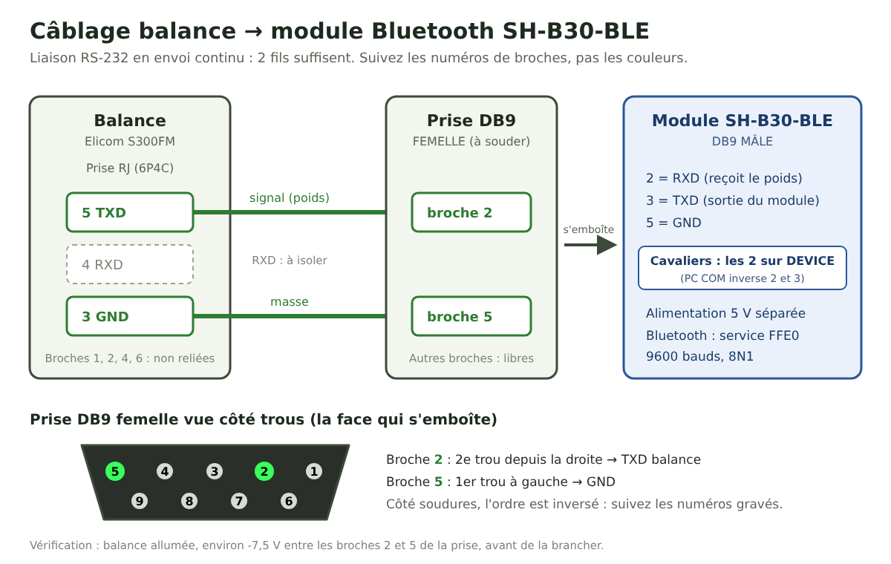

# Balance connectée pour la caisse Ouvretaferme

Ce petit script relie une balance de marché à la **caisse enregistreuse d'[Ouvretaferme](https://www.ouvretaferme.org)**. On pose le produit, on touche l'article dans la caisse, et le poids s'inscrit et s'enregistre tout seul.

Il ne modifie pas le site Ouvretaferme, n'utilise pas son API et ne demande aucune clé. Il s'ajoute simplement à la page de la caisse, ouverte dans le navigateur, à l'aide d'un favori.

> Projet indépendant, créé par un maraîcher, sans lien officiel avec Ouvretaferme. Une mise à jour de la caisse peut l'empêcher de fonctionner : vérifiez toujours le montant avant d'encaisser.

## Ce qui a été testé

| Élément | Testé avec | État |
|---|---|---|
| Balance | Elicom S300FM 15/30, en transmission continue | ✅ Fonctionne |
| Liaison Bluetooth | Adaptateur DSD TECH SH-B30-BLE (RS-232 vers Bluetooth Low Energy) | ✅ Fonctionne |
| Téléphone | Samsung Galaxy A14, Android 14, Chrome | ✅ Fonctionne |
| iPad | Navigateur Bluefy | ❌ Pas encore : la recherche Bluetooth est refusée (code 2) |
| USB direct | Câble DSD TECH SH-RJ12B (puce CP2102N) sur Android | ⚠️ Code présent, jamais validé en réel |

D'autres balances peuvent fonctionner si elles envoient le même format de trame : voir [Autres balances](docs/AUTRES-BALANCES.md).

## Comment ça marche

```
Balance ──RS-232──> SH-B30-BLE ──Bluetooth──> Chrome sur Android ──> caisse Ouvretaferme
```



1. La balance envoie son poids environ une fois par seconde, par exemple `P+000.245` pour 245 g.
2. Le module SH-B30-BLE transmet ce texte en Bluetooth.
3. Le script, lancé sur la page de la caisse, lit le poids et l'affiche dans un petit bandeau en haut.
4. Quand vous ouvrez un article vendu **au kilo**, il saisit le poids stable dans « Vendu » et touche **Enregistrer**.

## Les sécurités

- **Poids stable uniquement :** un poids en mouvement, négatif ou en surcharge n'est jamais saisi.
- **Mesure récente :** une mesure de plus de 2,5 secondes est refusée, et une déconnexion efface le dernier poids.
- **Correction respectée :** si « Vendu » contient déjà une valeur, le script n'écrit rien. Vous pouvez corriger à la main ou toucher **Poids**.
- **Pas de double pesée :** entre deux articles, le poids doit changer d'au moins 5 g ou repasser par zéro. Pratique pour peser plusieurs produits dans le même panier.
- **Articles à la pièce ignorés :** le script n'agit que si l'unité est le kilo.
- **Montant contrôlé :** si la caisse ne calcule pas le montant, le script n'enregistre pas.

## Matériel

- Une balance compatible, réglée en transmission continue à 9600 bauds (voir [Câblage et réglages](docs/CABLAGE.md)).
- Un adaptateur **DSD TECH SH-B30-BLE** et son alimentation 5 V.
- Un câble à fabriquer, de la prise RJ de la balance vers une prise **DB9 femelle**.
- Un téléphone ou une tablette **Android**, avec **Chrome** à jour.

## Installation

### 1. Héberger le script

Le script doit être accessible en ligne, à une adresse en `https://`. Deux possibilités :

- **Sur votre propre site** : déposez `balance-otf.js` sur votre hébergement, par exemple par FTP. C'est la méthode testée.
- **Depuis ce dépôt, via jsDelivr** (non testée) : `https://cdn.jsdelivr.net/gh/nicolasmieral-wq/balance-connectee-otf@<version>/balance-otf.js`. Remplacez `<version>` par le numéro d'un commit précis, pour que le script ne change pas sans que vous le sachiez.

### 2. Créer le favori

Dans Chrome sur un ordinateur, synchronisé avec le même compte Google que le téléphone :

1. Ouvrez le gestionnaire de favoris (Ctrl+Maj+O) et ajoutez un favori nommé **Balance OTF**.
2. Dans le champ URL, collez la ligne ci-dessous, en remplaçant l'adresse par celle de votre script :

```
javascript:void(document.head.appendChild(document.createElement('script')).src='https://VOTRE-SITE/balance-otf.js?v='+Date.now())
```

Chrome sur Android refuse souvent qu'on colle une ligne aussi longue : c'est pourquoi on passe par l'ordinateur et la synchronisation. Le `Date.now()` force le chargement de la dernière version à chaque lancement.

### 3. Lancer le script sur la caisse

1. Sur le téléphone, ouvrez une vente dans la caisse Ouvretaferme.
2. Touchez la barre d'adresse, effacez-la, tapez `Balance OTF` et touchez la **suggestion du favori**. Le lancer depuis la liste des favoris ne fonctionne pas.
3. Un petit bandeau apparaît en haut. Touchez **Bluetooth** et choisissez **SH-B30-BLE**.

Il faut relancer le favori à chaque rechargement de la page.

## Utilisation

- **Bandeau du haut :** le poids actuel, le bouton **Bluetooth** (masqué une fois relié), **Auto** et **×** pour retirer le script.
- **Auto (vert) :** posez le produit, touchez l'article, c'est enregistré.
- **Auto (gris) :** mode manuel. Ouvrez l'article et touchez **Poids**, sous « Vendu », puis **Enregistrer**.

Faites vos premiers essais sur une ferme ou une vente de test.

## Documentation

- [Câblage et réglages](docs/CABLAGE.md)
- [Dépannage](docs/DEPANNAGE.md)
- [Autres balances et protocoles](docs/AUTRES-BALANCES.md)

## Pour les développeurs

Le script est un seul fichier sans dépendance. Les tests se lancent avec Node.js :

```
node tests/balance-otf.test.js
```

Ils couvrent le décodage des trames, les règles de mesure, le Bluetooth et l'USB simulés. Le comportement dans la vraie caisse ne peut se vérifier qu'à la main.

Points d'appui dans la page de la caisse, à revoir si Ouvretaferme change son interface :

- champ « Vendu » : `input[name^="number["]` dans `.merchant-field` ;
- montant : `input[name="price[ID]"]` ;
- passage en saisie clavier : `.merchant-switch-keyboard-link`. Le pavé tactile limite à 2 décimales et ne recalcule pas le montant.

## Licence

[MIT](LICENSE).
