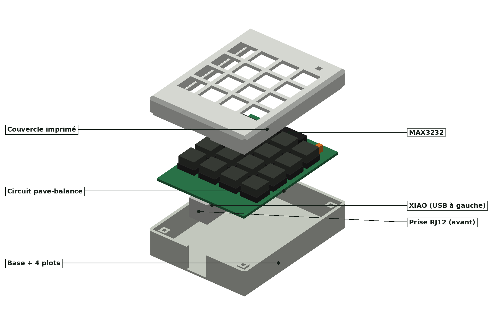
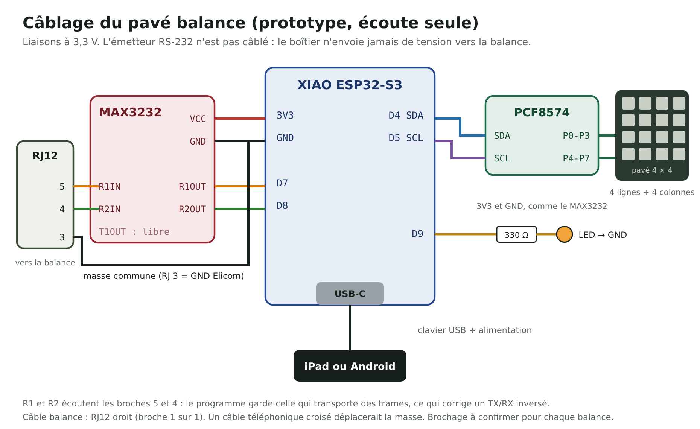

# Pavé balance USB-C (concept)

> **Concept non construit, non imprimé, non testé.** Cotes indicatives, à ajuster avec les vrais composants.
> La saisie manuelle au pavé correspond à la pratique habituelle. La lecture de la balance par la prise RJ12 relie la balance à la caisse : réservée aux essais, jamais à la vente (voir l'avertissement du [README principal](../README.md)).

Un pavé numérique 16 touches qui se branche en USB-C sur un iPad ou un téléphone, comme un clavier. En essai, la touche « Peser » tape le poids stable lu sur la balance par une prise RJ12, placée sur le bord avant.

## Fichiers

| Fichier | Contenu |
|---|---|
| `boitier-base.stl` | Base : parois et fond de 2 mm, ouverture USB-C sur le côté gauche, encoche RJ12 au milieu du bord avant, 4 plots qui portent le circuit |
| `boitier-dessus-rond.stl` | Couvercle pour capuchons **ronds** : trous ronds de 12,6 mm (réglable : `DIAM_ROND` dans `generer_boitier.py`, diamètre du capuchon + 0,5 mm). Le fichier contient deux volumes qui se chevauchent (parois et plaque), que le trancheur fusionne. |
| `boitier-dessus.stl` | Couvercle : 16 trous de 12,4 mm (pas de 15 mm), trou de LED, lèvre emboîtée (jeu 0,2 mm) |
| `generateur-boitier.html` | Générateur en ligne : place la fiche USB-C sur le côté, à la hauteur de la tablette, et télécharge les STL |
| `touche-test.stl` | 3 capuchons d'essai, logements de 3,9 / 4,1 / 4,3 mm (marqués 1, 2, 3) pour choisir le serrage sur la tige ; réglage retenu : 4,0 mm, profondeur 2,8 mm |
| `touches-chiffres.stl`, `touches-fonctions.stl` | Les 16 capuchons ronds Ø 12 mm, dessus creusé, inscriptions gravées : 1-9, 0, 00, virgule ; Effacer (flèche), P (peser), Entrée (flèche retour), A (auto). Logement 4,0 × 2,8 mm. Changement de filament juste au-dessus de 5,8 mm pour des inscriptions de la première couleur sur fond de la seconde |
| `generer_touches.py` | Génère les capuchons ; `python3 generer_touches.py . 4,1` pour un autre logement |
| `generer_boitier.py` | Génère les deux STL. Toutes les cotes sont en tête du fichier |
| `rendu_iso.py` | Dessine les vues 3D |
| `schema-pave.svg` / `.png` | Schéma de câblage |

Boîtier extérieur 70 × 92 × 28 mm, chanfreins de 2 mm sur les arêtes extérieures. Les deux maillages sont vérifiés fermés par le script.

Pour modifier une cote : changer la valeur dans `generer_boitier.py`, puis `python3 generer_boitier.py`. Aucune bibliothèque à installer.

## Impression

PETG ou PLA, couches de 0,2 mm, sans supports. Base à plat, couvercle retourné (dessus contre le plateau).

## Circuit imprimé

Le boîtier est dessiné pour le circuit du dossier [`circuit/`](../circuit/README.md) : grille des touches à 18,5 mm du bord avant (place pour la prise RJ12 sous le circuit), circuit posé à 17 mm de hauteur sur 4 plots (vis M2,5 autotaraudeuses dans des trous de 2,2 mm), XIAO suspendu sous le circuit avec sa prise USB-C sur le côté gauche, centrée à 54,6 mm de l'avant.

Le schéma de câblage ci-dessous correspond à l'ancienne version sur plaque à pastilles (avec PCF8574). Le circuit imprimé n'utilise plus le PCF8574.

- Câble balance droit (broche 1 sur 1) : un câble téléphonique croisé déplacerait la masse.

Le programme du XIAO n'est pas encore écrit.
