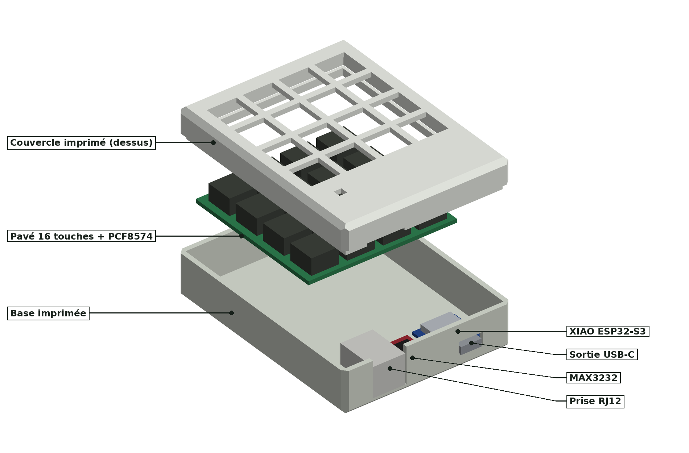
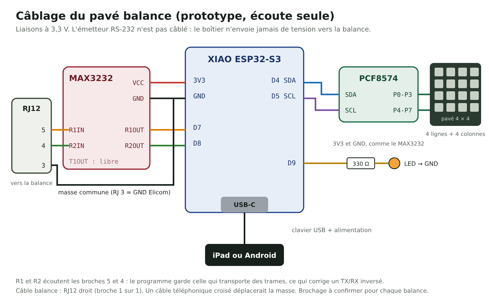

# Pavé balance USB-C (concept)

> **Concept non construit, non imprimé, non testé.** Cotes indicatives, à ajuster avec les vrais composants.
> La saisie manuelle au pavé correspond à la pratique habituelle. La lecture de la balance par la prise RJ12 relie la balance à la caisse : réservée aux essais, jamais à la vente (voir l'avertissement du [README principal](../README.md)).

Un pavé numérique 16 touches qui se branche en USB-C sur un iPad ou un téléphone, comme un clavier. En essai, la touche « Peser » tape le poids stable lu sur la balance par une prise RJ12.

## Fichiers

| Fichier | Contenu |
|---|---|
| `boitier-base.stl` | Base : parois et fond de 2 mm, ouverture USB-C et encoche RJ12 |
| `boitier-dessus.stl` | Couvercle : 16 trous de 12,4 mm (pas de 15 mm), trou de LED, lèvre emboîtée (jeu 0,2 mm) |
| `generer_boitier.py` | Génère les deux STL. Toutes les cotes sont en tête du fichier |
| `rendu_iso.py` | Dessine les vues 3D |
| `schema-pave.svg` / `.png` | Schéma de câblage |

Boîtier extérieur 70 × 92 × 28 mm, chanfreins de 2 mm sur les arêtes extérieures. Les deux maillages sont vérifiés fermés par le script.

Pour modifier une cote : changer la valeur dans `generer_boitier.py`, puis `python3 generer_boitier.py`. Aucune bibliothèque à installer.

## Impression

PETG ou PLA, couches de 0,2 mm, sans supports. Base à plat, couvercle retourné (dessus contre le plateau).

## Composants

XIAO ESP32-S3, module MAX3232 3,3 V, module PCF8574, 16 boutons 12 × 12 mm et capuchons carrés, plaque à pastilles 62 × 62 mm, prise RJ12 pour circuit imprimé, LED 3 mm et résistance 330 Ω, câble RJ12 droit, câble USB-C vers USB-C.

## Câblage

- RJ12 broche 5 → MAX3232 R1IN, broche 4 → R2IN, broche 3 → masse (Elicom S300FM). Le programme écoute les deux récepteurs : un TX/RX inversé fonctionne.
- MAX3232 R1OUT → D7, R2OUT → D8. Émetteur non câblé : rien n'est envoyé à la balance.
- PCF8574 SDA → D4, SCL → D5, P0-P3 lignes et P4-P7 colonnes du pavé.
- LED sur D9 avec 330 Ω.
- Câble balance droit (broche 1 sur 1) : un câble téléphonique croisé déplacerait la masse.

Le programme du XIAO n'est pas encore écrit.
