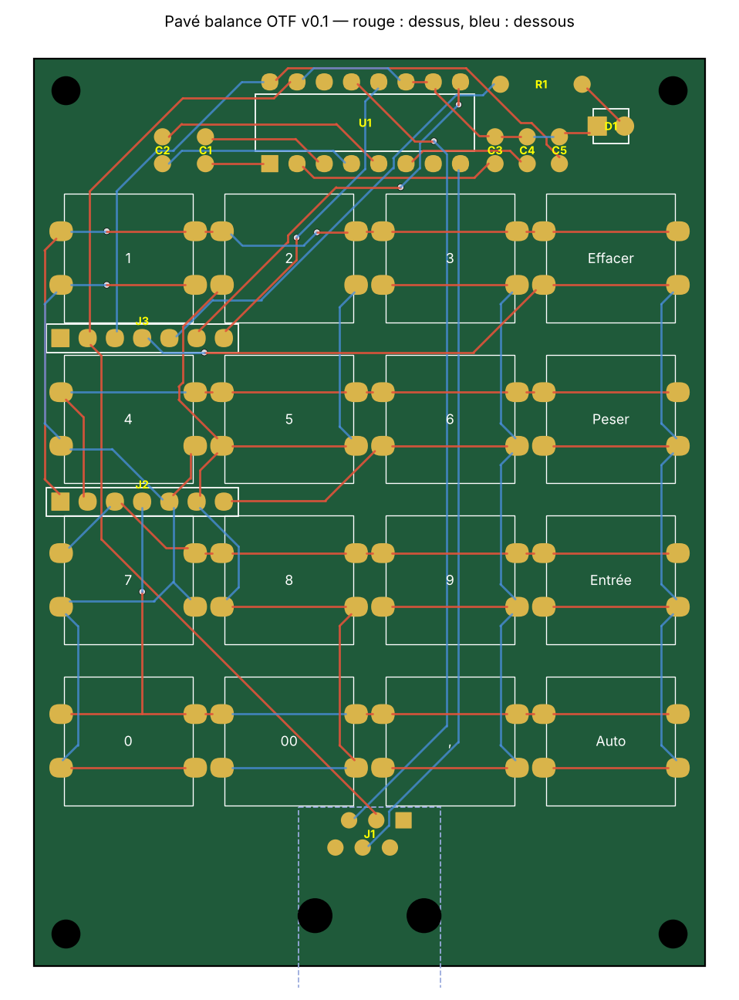

# Circuit imprimé du pavé balance (prototype)

> **Prototype non fabriqué, non testé.** Contrôles KiCad 10 : 0 erreur, 0 connexion manquante, schéma et circuit identiques. Réservé aux essais, jamais à la vente (voir l'avertissement du [README principal](../README.md)).

Circuit 62,6 × 84,6 mm, 2 couches, pistes 0,3 mm, isolement 0,2 mm (0,25 mm mesuré), vias 0,6/0,3 mm. Composants traversants, faciles à souder.

## Composants

| Repère | Composant | Empreinte KiCad |
|---|---|---|
| SW1-SW16 | Boutons 12 × 12 mm + capuchons carrés | Button_Switch_THT:SW_PUSH-12mm (pastilles réduites à 2,2 mm) |
| U1 | MAX3232 en DIP-16 (support conseillé) | Package_DIP:DIP-16_W7.62mm |
| C1-C5 | Condensateurs céramique 100 nF, pas de 2,5 mm | Capacitor_THT:C_Disc_D3.0mm_W1.6mm_P2.50mm |
| R1 | Résistance 330 Ω | Resistor_THT:R_Axial_DIN0207… |
| D1 | LED 3 mm | LED_THT:LED_D3.0mm |
| J1 | Prise RJ12 Amphenol 54601 (6P6C), **montée dessous** | Connector_RJ:RJ12_Amphenol_54601 |
| J2, J3 | Barrettes 1 × 7 au pas de 2,54 mm, pour le XIAO ESP32-S3 **suspendu dessous** | Connector_PinHeader_2.54mm:PinHeader_1x07 |
| H1-H4 | Trous M2,5 | — |

## Connexions

- Pavé 4 × 4 en matrice, sans diodes : lignes sur D0-D3, colonnes sur D4, D5, D6, D10.
- RJ12 broche 5 → MAX3232 R1IN → R1OUT → D7 ; broche 4 → R2IN → R2OUT → D8 ; broche 3 → masse. Émetteurs non câblés : rien n'est envoyé à la balance.
- LED sur D9 par R1. MAX3232 alimenté en 3,3 V par le XIAO.

## À vérifier avant de commander

- Écart entre les deux rangées de broches du XIAO (15,24 mm retenu) : mesurer au pied à coulisse.
- Longueur des barrettes du XIAO (environ 14 mm entre le XIAO et le circuit).
- Hauteur des boutons et capuchons par rapport au couvercle (circuit à z = 17, dessous du couvercle à z = 26).
- Sens d'ouverture de la prise RJ12 (vers le bord avant).

## Fichiers

| Fichier | Rôle |
|---|---|
| `pave-balance.kicad_pro/.kicad_sch/.kicad_pcb` | Projet KiCad (s'ouvre dans KiCad 8 à 10) |
| `pave.kicad_sym`, `sym-lib-table` | Symboles du schéma |
| `generer_pcb.py` | Régénère schéma, placement et routage (Python 3 + numpy) |
| `verifier.py` | Contrôle indépendant des isolements et de la continuité |
| `rendu_pcb.py` | Dessine `apercu.png` |

## Fabrication

Fichier prêt : `pave-balance-gerbers.zip` (Gerber + perçage, généré par KiCad 10). Pour le refaire dans KiCad : *Fichiers → Fabrication → Gerbers*, puis *Générer fichiers de perçage*. Compresser le dossier obtenu en ZIP et l'envoyer au fabricant. Réglages courants : 2 couches, 1,6 mm, finition HASL.
