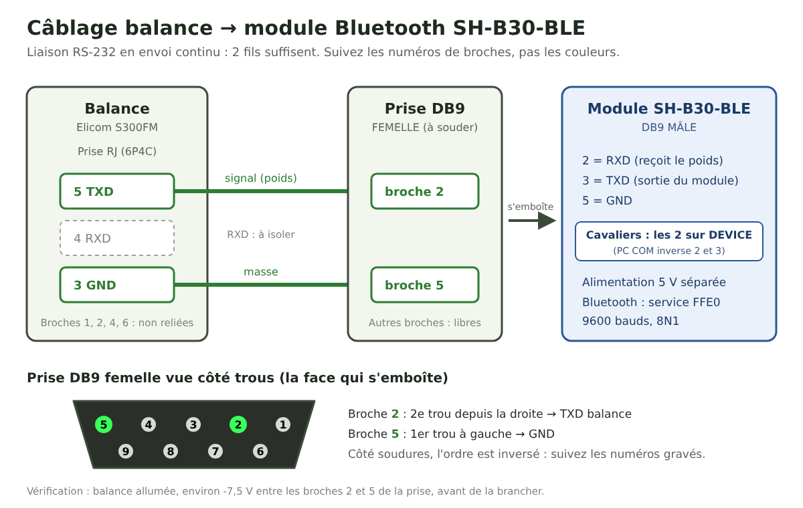

# Câblage et réglages

## Réglages de la balance Elicom S300FM

Dans le menu de configuration de la balance :

| Paramètre | Valeur | Effet |
|---|---|---|
| `BAUD1` | `009.6` | 9600 bauds |
| `PAR-1` | `00` | 8 bits, sans parité, 1 bit d'arrêt |
| `PROT1` | `08` | Envoi continu du poids, sans demande |
| `NET1` | `00` | Réglage du montage testé |

Avec `PROT1 = 08`, la balance envoie environ une trame par seconde. Le module n'a rien à lui envoyer : **deux fils suffisent**.

## Le module DSD TECH SH-B30-BLE

- Connecteur **DB9 mâle**. Brochage annoncé : 2 = réception (RXD), 3 = émission (TXD), 5 = masse (GND). Les autres broches ne sont pas reliées.
- Liaison série par défaut : 9600 bauds, 8 bits, sans parité, 1 bit d'arrêt.
- Deux cavaliers marqués **PC COM** et **Device** inversent l'émission et la réception. **Mettez-les tous les deux sur Device.**
- Bluetooth : service `FFE0`, caractéristique `FFE1` (notification et écriture).
- Il lui faut une alimentation 5 V séparée.

Contrôle au multimètre, module allumé et débranché : sur **Device**, on lit environ -7,5 V entre les broches 5 et 3, et rien entre 5 et 2. La broche qui affiche une tension est la sortie du module.

## Le câble

Côté balance, la prise est une **RJ 6 positions à 4 contacts** (appelée RJ11 6P4C dans la notice Elicom). Côté module, il faut une prise **DB9 femelle**.

| Balance (RJ) | Signal | DB9 femelle côté module |
|---|---|---|
| **5** | TXD balance | **2** |
| **3** | GND | **5** |
| 4 | RXD balance | non relié |

C'est le même brochage que le câble Elicom prévu pour un PC (TXD 5 → 2, RXD 4 → 3, GND 3 → 5), avec le fil RXD en moins.

**Ne vous fiez pas aux couleurs des fils ni aux dessins.** Elles changent d'un câble à l'autre, et l'ordre des broches s'inverse selon le côté d'où l'on regarde la prise. Sur le câble du projet, le fil de la broche 5 était noir et celui de la masse vert, mais un premier repérage fait d'après photo était inversé. La photo [cablage-exemple.jpg](cablage-exemple.jpg) ne vaut que pour ce câble-là.

Sur la prise DB9 femelle, suivez les **numéros gravés**. Vue côté trous, rangée de 5 en haut, la broche 2 est le 2e trou en partant de la droite, et la broche 5 le trou tout à gauche.

## Vérifier avant de brancher

1. **Le fil de la balance :** au multimètre, entre TXD et GND de la balance allumée, on lit une tension négative d'environ -7,5 V.
2. **La continuité :** la même tension doit se retrouver entre les broches 2 et 5 de la prise DB9.
3. **La transmission :** une tension fixe ne prouve pas que les trames passent. Le plus sûr est de tester le câble sur un ordinateur avec un adaptateur USB–RS-232. Sur Mac : `screen /dev/cu.SLAB_USBtoUART 9600`, puis le poids doit défiler. Pour quitter : Ctrl+A, K, Y.
4. **Le module :** dans l'appli gratuite **nRF Connect** (Android), connectez-vous au module, activez les notifications sur `FFE1` et ouvrez le journal. Des lignes « Notification received » commençant par `50-2B` (pour `P+`) doivent arriver chaque seconde.
